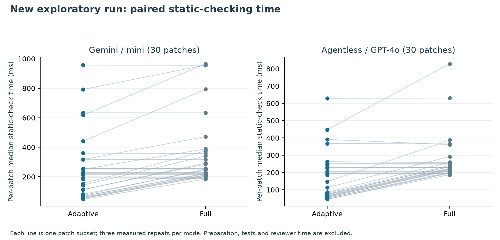
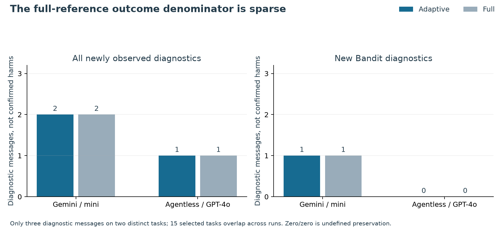
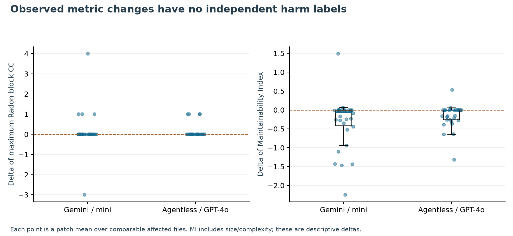

# PATCH-GATE

### Risk-adaptive verification of AI-generated software changes

**Research prototype · Version 0.1.1 · Python 3.11+ · Local execution**

PATCH-GATE explores how software teams can decide **where to spend additional verification effort on an AI-generated change**. It combines patch context, before-and-after static analysis, and explicit evidence gaps into a reviewable report.

The central research question is:

> Can we find real problems in AI-generated changes while spending less time checking them?

This repository provides a working foundation for investigating that question: an executable Python prototype, automated tests, synthetic examples, and a new exploratory static-check evaluation of 60 public AI-patch subsets. Its effectiveness on independently confirmed real-world problems remains to be evaluated.

## Why this work matters

A passing test suite answers specific questions about observed behavior. A code-quality metric or security scanner answers different questions, each with its own limitations. Teams still need to decide which additional checks are relevant, what the available evidence supports, and which uncertainties require human attention.

PATCH-GATE makes those decisions visible. Its current policy uses transparent rules to select additional static checks, records the reason for each selection or omission, and compares findings against the patch's base version. The research direction is to evaluate these decisions under explicit verification budgets.

## What works today

| Capability | Current implementation |
|---|---|
| Patch intake | Apply a text patch to temporary copies of affected files; preserve the input checkout |
| Change context | Identify changed Python functions and syntactically recognized security-sensitive imports and calls |
| Before/after checks | Syntax checking, Ruff lint, and descriptive Radon/AST quality measurements |
| Adaptive security scanning | Request Bandit for selected files and explicitly record skipped scans |
| Diagnostic attribution | Match existing warnings across line shifts and report newly observed or no-longer-observed diagnostics |
| Evidence reporting | Self-contained HTML, detailed JSON, check status, source hashes, tool versions, and selection reasons |
| Measured comparison | Adaptive versus full static checking, with warm-up runs, repeated timings, and missed-diagnostic reporting |

Candidate code and project tests are never executed by the current prototype. Analysis runs locally without model APIs, runtime downloads, AWS, or cloud compute.

## How it works

```mermaid
flowchart LR
    A[Python patch and local base] --> B[Temporary before/after snapshots]
    B --> C[Changed-function and sensitive-context inspection]
    C --> D[Syntax, lint, and quality descriptions]
    D --> E[Transparent selection policy]
    E --> F[Run Bandit or record a skipped check]
    F --> G[Compare diagnostics and record evidence gaps]
    G --> H[HTML and JSON evidence report]
```



For each affected Python file $f$, the current Bandit-selection rule is:

$$
g(f)=\mathbf{1}\left[S(f)=1\;\lor\;C(f)\geq20\;\lor\;U(f)=1\right].
$$

$S$ indicates recognized sensitive context, $C$ counts added-plus-removed source lines, and $U$ indicates a context-parse failure. This fixed rule is illustrative, not a calibrated risk threshold. Full mode requests all supported static checks on every affected Python file.

## Metrics and measurement model

For a metric observed on the same unit before and after a patch:

$$
\Delta m=m_{\mathrm{after}}-m_{\mathrm{before}}.
$$

A conventional control-flow definition of cyclomatic complexity is $CC=E-N+2P$. The implementation uses Radon's Python AST rules and records block summaries. A positive complexity delta is a description of added control flow, not automatically a defect.

| Dimension | Current status | Interpretation and next step |
|---|---|---|
| Cyclomatic complexity | **Implemented:** Radon block mean/max | Helps locate branching changes; a necessary guard can increase CC |
| Cognitive complexity | **Proposed extension** | Pin a method-level analyzer for flow/nesting rules; validate its interpretation before reporting values |
| Exception handling | **Proposed extension** | Profile broad/bare handlers, pass-only bodies, re-raises and cleanup; counts alone do not establish correct error handling |
| Depth of inheritance | **Proposed extension** | Resolve the class hierarchy and report unknown bases explicitly; Python's dynamic/multiple inheritance makes naive depth unreliable |
| Code maintainability | **Implemented proxy:** Maintainability Index | MI combines size/complexity/comment inputs; it is not measured maintenance effort or a quality percentage |
| Method structure | **Implemented descriptions:** nesting, function count and maximum function length | Localized, matched per-method measurements are a future extension |
| Quality of developed methods | **Proposed multi-evidence profile** | Combine contextual measurements with independent tests/review evidence; no validated universal scalar score is claimed |

Our design position is to retain interpretable evidence dimensions before inventing a weighted quality score. MI and its component metrics should not be counted as independent harms. Adding exception handling can improve robustness while raising complexity. Inheritance depth is useful for class-oriented changes, but is a lower-priority signal for many Python functions.

[Metric definitions, exact MI formula, exception/DIT conventions, and proposed evaluation equations](docs/METRICS_AND_EQUATIONS.md) distinguish implemented calculations from future work.

## Quick start

Python 3.11+ and Git are required. Dependencies are free; installing them uses PyPI. The analysis itself runs locally.

```sh
python3 -m venv .venv
.venv/bin/python -m pip install -r requirements-pilot-dev.txt

.venv/bin/python patch_gate.py \
  --repo examples/eval/base \
  --patch examples/eval/change.diff \
  --mode compare \
  --output outputs/first-example
```

Open `outputs/first-example/report.html`. The same directory contains `report.json` and `comparison.csv`. Use a new or empty output directory for each run so earlier evidence is preserved.

### Analyze your own patch

```sh
.venv/bin/python patch_gate.py \
  --repo /path/to/project \
  --patch /path/to/change.diff \
  --base worktree \
  --mode compare \
  --repeats 3
```

`worktree` reads the current files on disk. If the checkout already contains the change, provide the appropriate local Git base commit with `--base COMMIT_SHA`. PATCH-GATE reads that commit without checking it out or resetting your files.

| Mode | Purpose |
|---|---|
| `adaptive` | Run the policy-selected static checks and expose omissions |
| `full` | Request all supported static checks on affected Python files |
| `compare` | Run both modes and compare checking time and diagnostic output |

See [the usage guide](docs/USAGE.md) for supported patch formats, scanner settings, timeouts, and optional CI exit codes.

## Reproduce the demonstration

```sh
.venv/bin/python -m pilot.demo --repeats 3
.venv/bin/python -m pytest -q
```

The demonstration creates a new directory under `outputs/`, with an index, per-case reports, synthetic inputs, raw timings, and a manifest. Its four cases exercise:

- A newly observed warning after adding an `eval` call.
- A small documentation edit.
- An existing warning that moves to another line.
- A warning deliberately missed by the adaptive policy.

That last case exposes a limitation of selective checking. These examples demonstrate implementation behavior; they are not a representative dataset or evidence of real-world detection accuracy.


## New exploratory evaluation: 60 public AI-patch subsets

These are **new executions of the current tool**, separate from the four-case synthetic demonstration. We selected 30 historically benchmark-resolved patches from each of two public runs using repository round-robin sampling and a fixed seed. Only supported production-Python diff subsets were analyzed. No repository tests or candidate code were executed.

| Public run | Resolved pool | Selected | Repositories | Affected Python files | Complete full references |
| --- | --- | --- | --- | --- | --- |
| Gemini / mini | 359 | 30 | 10 | 38 | 30 |
| Agentless / GPT-4o | 194 | 30 | 11 | 30 | 30 |

The two selected cohorts share 15 task IDs. They are not independent problem populations, and the repository-balanced selection is not a uniform estimate of benchmark-wide performance.

### Checking time

For per-case timings after warm-up:

$$
S_T(p)=100\left(1-
\frac{\operatorname{median}_rT_{A,r}(p)}{\operatorname{median}_rT_{F,r}(p)}\right).
$$

$A$ and $F$ denote adaptive and full checking. Negative values mean adaptive checking was slower. The table's workload reduction is computed from the **sum of per-patch median times**, not the ratio of the two cohort medians.

| Public run | Adaptive median/patch (ms) | Full median/patch (ms) | Reduction in summed per-patch medians |
| --- | --- | --- | --- |
| Gemini / mini | 203.5 | 254.3 | 30.5% |
| Agentless / GPT-4o | 130.0 | 227.1 | 36.1% |



*Each line represents a patch subset; three measured repetitions per mode. Selection and subprocess startup are included. Shared snapshot preparation, warm-up, report generation, project tests and reviewer time are excluded.*

### Scanner output and omitted evidence

| Public run | New diagnostics: adaptive / full | New Bandit warnings: adaptive / full | Skipped Bandit snapshots |
| --- | --- | --- | --- |
| Gemini / mini | 2 / 2 | 1 / 1 | 38 |
| Agentless / GPT-4o | 1 / 1 | 0 / 0 | 34 |



Full mode observed only three new diagnostic messages: an F401 lint warning on the same requests task in both runs, and a B310 Bandit warning on a separate pytest task. Adaptive mode observed those same messages. This denominator is too sparse to establish reliable detection or security effectiveness. The second run's 0/0 new Bandit count is **undefined preservation**, not perfect detection.

For comparable diagnostic multisets, the output-preservation statistic is:

$$
P_D=\frac{\sum_d\min\{n_A(d),n_F(d)\}}{\sum_dn_F(d)},
\qquad\sum_dn_F(d)>0.
$$

This compares scanner output, not independently confirmed defects. Skipped before/after Bandit snapshots remain missing evidence even when no warning was observed. The synthetic assert case separately demonstrates a policy miss.

### Observed quality-metric changes



*Points are patch-level means over comparable affected-file deltas. They have no independent harm labels. CC/MI movement alone does not establish a maintenance or security problem.*

| Public run | Comparable patches | Mean CC-max delta | Median CC-max delta | Mean MI delta | Median MI delta |
|---|---:|---:|---:|---:|---:|
| Gemini / mini | 30 | 0.133 | 0 | -0.323 | -0.0524 |
| Agentless / GPT-4o | 30 | 0.133 | 0 | -0.158 | -0.00644 |

These are descriptive observations from the selected subsets, not evidence that one model is better or that any positive complexity change is harmful. Cognitive complexity, exception profiles and inheritance depth have not been computed in this evaluation.

**Reproducible evidence:** [per-patch measurements](docs/assets/data/public_patch_per_case.csv), [full metric summary](docs/assets/data/public_patch_metric_summary.csv), [cohort and hashes](docs/assets/data/public_patch_cohort.json), [candidate accounting](docs/assets/data/public_patch_accounting.csv), and [protocol](docs/assets/data/public_patch_protocol.json).

**Paper material:** [methods/results section with equations, tables and figures](paper/METHODS_AND_RESULTS.md). This is a paper-ready evidence section, not a claim that the whole study is submission-ready. [The next outcome-based experiment](paper/NEXT_EXPERIMENT.md) specifies what would strengthen the central contribution.

Rebuild the charts locally from their frozen CSV snapshot:

```sh
.venv/bin/python -m pip install -r requirements-docs.txt
MPLCONFIGDIR=/tmp/patch-gate-mpl .venv/bin/python scripts/build_public_pilot_results.py --frozen
MPLCONFIGDIR=/tmp/patch-gate-mpl .venv/bin/python scripts/build_readme_figures.py
```

No upstream source checkout is needed to regenerate these figures. [Experiment instructions](experiments/README.md) explain rescanning and replaying the preserved public-patch inputs.

## Reviewer validation experiments (November 2026)

Additional experiments compare PATCH-GATE's existing verification
policy against simpler alternatives and examine its diagnostic
coverage. The core implementation and default policy are unchanged.

### Policy comparison

We retrospectively evaluated 60 public patch records across two
30-patch cohorts.

| Policy | Gemini: files selected (of 38) | Gemini: Bandit warnings preserved | Agentless: files selected (of 30) |
|---|---:|---:|---:|
| Full checking | 38 | 1/1 | 30 |
| PATCH-GATE combined | 19 | 1/1 | 13 |
| Context-only | 18 | 1/1 | 13 |
| Size-only | 3 | 0/1 | 0 |
| Random, matched budget | 19 | 0/1 | 13 |

No newly observed Bandit warnings were present in the Agentless
full reference. Preservation is therefore undefined for that cohort.

Context-only selection matched the combined policy's observed
warning preservation while selecting one fewer Gemini file.
The random result represents one fixed-seed allocation.

Threshold sensitivity was evaluated at 10, 15, 20, 25, and 30
changed lines. At thresholds 20 through 30, selected-file counts
were unchanged.

[Complete policy comparison results](paper/tables/reviewer_policy_comparison.csv)

### Controlled diagnostic stress testing

Thirteen constructed Python scenarios produced 15 newly observed
Bandit warning messages under full checking.

- Adaptive checking preserved 12 of 15 messages.
- Three messages were missed: B101, B105, and B306.
- Cases also exercised warning movement, duplication, and benign edits.

These experiments test scanner and selection behavior using
in-memory snapshots. They do not establish real-world vulnerability
recall or independently confirmed security defects.

[Diagnostic stress results](paper/tables/reviewer_diagnostic_stress.csv)

### Reproduction

Install dependencies and run:

```bash
.venv/bin/python -m pip install -r requirements-pilot-dev.txt
.venv/bin/python -m pytest -q
.venv/bin/python -m experiments.diagnostic_stress
.venv/bin/python -m experiments.compare_policies
```

The policy-comparison script requires the original detailed
full-reference JSON reports under `outputs/`. Those reports are
not committed to GitHub. The committed CSV preserves the recorded
results but cannot reproduce the comparison by itself.

### Environment and limitations

- macOS 26.5, Apple M5, 16 GB RAM
- Python 3.14.6
- Existing automated tests: 29 passed
- Alternative-policy execution times were not measured.
- Public-patch observations contain only one new Bandit warning.
- Scanner warnings are not independently verified vulnerabilities.

[Experimental environment](paper/REVIEWER_EXPERIMENT_ENVIRONMENT.md)

## Research roadmap

The following directions are **planned work**, not capabilities or findings established by this release.

| Direction | Proposed work | Evidence to collect |
|---|---|---|
| Real-patch evaluation | Curate versioned public patch cohorts and freeze development/evaluation splits | Provenance, exclusions, repository/task separation, and independently supported outcomes |
| Budget-aware selection | Compare transparent and learned policies against full checks, size-based selection, and random allocation | Problems caught/missed, false alarms, operational failures, and total checking cost |
| Contextual quality assessment | Investigate localized changes, developer-reference comparisons, and justified deterioration thresholds | Expert or test evidence separating necessary code changes from practical maintenance problems |
| Stronger security and behavioral verification | Investigate additional local checks and isolated test execution | Introduced versus pre-existing problems, reproducible failure evidence, and stage-specific coverage |
| Developer workflow evaluation | Explore CI integration and studies with software maintainers | Review effort, usability, useful escalations, and unresolved evidence gaps |

Success will be judged by measured verification outcomes under stated resource constraints. Evaluations should report where the method helps, where simple alternatives perform better, and where evidence is insufficient. Thresholds and policies should be fixed before evaluating their final test cohorts.

Potential collaboration areas include independently labeled patch collections, replication studies, security-check integration, and maintainer-led workflow evaluations.

## Interpreting the evidence

A scanner warning is a signal for investigation, not a confirmed vulnerability. A quality-metric increase does not automatically mean harmful deterioration. A skipped or failed check represents missing evidence. No report certifies a patch as safe or complete.

The current tool measures static-checking time and scanner output; the public-patch pilot adds descriptive observations, not independent harm labels. Claims about defect-detection effectiveness, reviewer-time savings, calibrated confidence, or production readiness require further validation. [Research scope](docs/RESEARCH_SCOPE.md) describes the distinction between implemented components and the evidence needed for stronger claims.

## Project layout

```text
patch-gate-framework/
├── patch_gate.py                 # Command-line entry point
├── pilot/                       # Snapshot handling, checks, reports, and demo
├── tests/test_pilot.py           # Standalone automated tests
├── examples/eval/               # Runnable synthetic patch example
├── docs/USAGE.md                 # Detailed behavior and operational limits
├── docs/RESEARCH_SCOPE.md        # Current evidence and evaluation requirements
├── docs/METRICS_AND_EQUATIONS.md # Metric definitions and interpretation
├── docs/assets/                 # Versioned figures and tabular snapshots
├── experiments/                 # Explicit public-patch evaluation and replay
├── scripts/                     # Reproducible documentation figures
├── paper/                       # Methods/results, tables, figures and next protocol
├── requirements-pilot.txt       # Runtime dependencies
├── requirements-pilot-dev.txt   # Runtime and test dependencies
├── requirements-lock.txt        # Recorded development environment
├── requirements-docs.txt        # Optional chart-generation dependency
└── outputs/                     # Generated reports; ignored by Git
```

The main CLI and demonstration are self-contained and do not require external research datasets or artifact caches. Tests cover checkout preservation, source non-execution, patch isolation, diagnostic matching, operational failures, and report behavior.

A distribution license and author/citation metadata should be selected before a public release.
