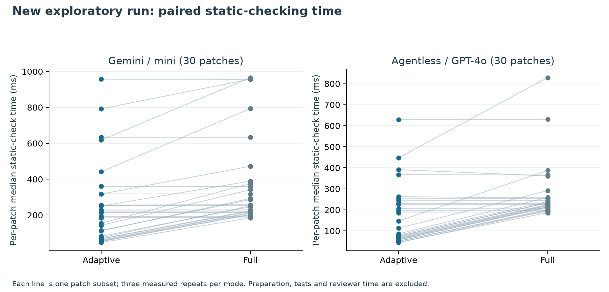
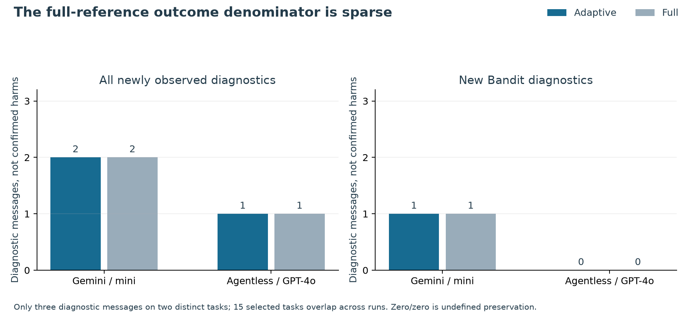
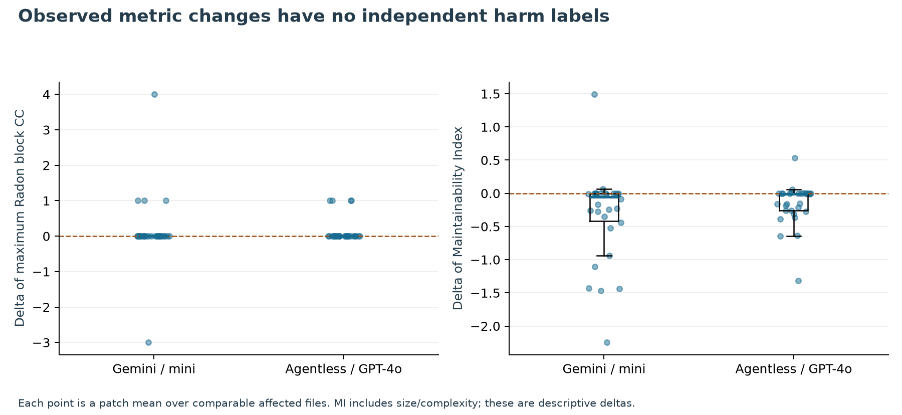

# PATCH-GATE: method and evaluation

PATCH-GATE organizes the static verification of AI-generated software changes around patch context, selective check execution, and before-and-after evidence. For each candidate change, the method identifies affected Python code, records structural quality measurements, and determines whether to request additional security scanning. Its output links each diagnostic to the analyzed snapshots and records the reasons for checks that were selected or skipped.

We evaluate the implementation on 60 production-Python patch subsets drawn from two public SWE-bench Verified runs. The evaluation compares adaptive and full static checking on the same inputs and tool configurations, measuring checking time, newly observed diagnostics, and structural metric changes. This design makes the relationship between checking cost and collected evidence inspectable at the file and patch levels. The following sections describe the decision procedure, measurement definitions, cohort construction, and observed results.

## 1. Objective and implementation

The input consists of a text patch and its local base version. PATCH-GATE processes the change in four stages:

1. **Snapshot construction.** Affected files are copied to a temporary directory and the patch is applied there. This provides comparable source snapshots while preserving the input checkout.
2. **Context inspection.** Python syntax trees identify changed functions, branching/nesting structure, and recognized sensitive imports or calls. Context is inspected in both snapshots so removed sensitive code also informs the checking decision.
3. **Check selection and execution.** Syntax, lint, and descriptive quality measurements are requested for affected Python files. A fixed context/churn policy determines whether Bandit is additionally requested for each file.
4. **Evidence attribution.** Before/after diagnostics are matched to identify newly observed, matched, and no-longer-observed messages. The evidence record includes source hashes, tool versions, check status, selection reasons, and elapsed checking time.

The implementation performs source inspection and static analysis; candidate code and repository tests are not executed. Published benchmark verdicts supply the historical functional-status metadata used in cohort construction.

The additional-scan decision for affected file $f$ is:

$$
g(f)=\mathbf{1}\left[S(f)=1\lor C(f)\geq20\lor U(f)=1\right]. \tag{1}
$$

$S$ denotes syntactically recognized sensitive context in either snapshot, $C$ added-plus-removed source lines, and $U$ context-parse failure. The threshold of 20 lines is a fixed engineering choice in this implementation. It allows direct evaluation of a transparent policy without fitting parameters to the evaluation outcomes. Full mode requests all supported checks on affected files, providing a scanner-output reference for the adaptive decisions. A skipped check remains an unobserved part of the evidence record.

Diagnostics are matched one-to-one by rule/message/source context, prioritizing unchanged-line mappings. Content-based relocation matches are explicitly approximate and can misattribute context-dependent warnings. “Newly observed” and “no longer observed” therefore describe scanner messages, not independently established vulnerability introduction/remediation.

## 2. Quality measurements and interpretation

For a comparable measurement unit $u$:

$$
\Delta m(u)=m_{after}(u)-m_{before}(u). \tag{2}
$$

The prototype records affected-file Radon block CC summaries, Maintainability Index, Halstead volume, AST nesting, function count and maximum function length. Conventional cyclomatic complexity has the graph definition:

$$
CC=E-N+2P, \tag{3}
$$

while the implementation uses pinned Radon Python AST rules. Positive movement is not equated with harmful deterioration. MI combines complexity, size and comment information and is not an independent non-complexity outcome or a measured percentage of quality. Per-patch descriptive deltas below are arithmetic means over comparable affected-file deltas; missing before/after metrics are not imputed to zero.

These measurements describe different aspects of the same changed code. CC records branching structure, nesting records control-structure depth, and function length records method size. MI summarizes several related inputs and is therefore interpreted alongside its components rather than counted as an independent quality outcome. For example, a guard clause may add a decision path while satisfying an intended behavioral requirement. Accordingly, the analysis reports the magnitude and direction of metric changes without assigning a defect label from the sign alone.

[Detailed metric conventions](../docs/METRICS_AND_EQUATIONS.md) document the installed MI expression, measurement units, and definitions proposed for future cognitive-complexity, exception-handling and inheritance analyses.

## 3. Experimental protocol

We selected 30 historically resolved patches from each of two public SWE-bench Verified runs. Candidates within repository were ordered by SHA256(seed:instance_id), with seed 42, and selected round-robin over repositories. Selection preceded scanner outcomes. All 359 original-run resolved candidates and all 194 second-run candidates were eligible under the available-source and supported-diff criteria. Repository-balanced selection emphasizes breadth across projects; the resulting summaries describe the selected subsets rather than benchmark-wide prevalence.

The two public runs are `20260901_mini-v2.4.2_gemini-3-5-flash` and `20241028_agentless-1.5_gpt4o`; the latter's predictions/verdicts are pinned to archive commit `dda1f6e6338c69111516d86e95fa3c21c63e0f9e`. Recorded functional verdicts were not rerun locally. Only supported production-Python text-diff subsets were materialized at their exact base commits; test/non-Python modifications are outside the experiment's checking scope.

**Table 1. Newly executed public-patch pilot cohort.**

| Public run | Resolved pool | Selected | Repositories | Affected Python files | Complete full references |
| --- | --- | --- | --- | --- | --- |
| Gemini / mini | 359 | 30 | 10 | 38 | 30 |
| Agentless / GPT-4o | 194 | 30 | 11 | 30 | 30 |

Fifteen selected task IDs are shared across the runs, so results are reported by cohort and cross-run records are not treated as independent problems. The generated patches come from existing public artifacts, including cohorts used in earlier exploratory analyses; all measurements and checking-time outcomes reported here were newly computed with the current implementation. Public input identities, checksums, candidate accounting, selected source hashes, and detailed per-patch reports are retained for reproduction.

The environment used Python 3.14 with Ruff 0.17.2, Bandit 1.9.4 and Radon 6.0.1. Ruff uses isolated E4/E7/E9/F rules with noqa suppressions ignored; Bandit ignores nosec suppressions and runs in an empty working directory. Scanner subprocesses use isolated Python mode. Missing, failed and timed-out snapshots remain explicitly recorded. All 60 full references completed, and new diagnostic identities were stable across the measured repetitions.

## 4. Cost definition and timing results

Each mode was warmed once, followed by three measured runs with alternating mode order. For patch $p$:

$$
S_T(p)=100\left(1-\frac{\operatorname{median}_rT_{A,r}(p)}{\operatorname{median}_rT_{F,r}(p)}\right). \tag{4}
$$

Timing includes selection/context inspection, static checks, subprocess startup and diagnostic comparison. Shared source materialization, warm-up and report generation are excluded. The experiment does not measure repository-test or human-review time. Repetitions quantify local timing variability and are not additional independent patches.

For a selected cohort $\mathcal P$, the workload proxy in Table 2 is:

$$
S_{\Sigma}=100\left(1-\frac{\sum_{p\in\mathcal P}\operatorname{median}_rT_{A,r}(p)}{\sum_{p\in\mathcal P}\operatorname{median}_rT_{F,r}(p)}\right). \tag{5}
$$

It is not the ratio of cohort median times, nor the wall-clock duration of the experiment driver.

**Table 2. Descriptive checking-time outcomes.**

| Public run | Adaptive median/patch (ms) | Full median/patch (ms) | Reduction in summed per-patch medians |
| --- | --- | --- | --- |
| Gemini / mini | 203.5 | 254.3 | 30.5% |
| Agentless / GPT-4o | 130.0 | 227.1 | 36.1% |

**Figure 1.** Each line represents one selected production-Python patch subset. Adaptive mode reduced the sum of per-patch median checking times by 30.5% and 36.1% in the two cohorts. The paired observations show how the effect varies across patches: files that trigger the additional scanner receive similar checking work in both modes, while omitted scanner invocations reduce work on other files. Some adaptive runs were slower. These measurements concern the implemented local static-check pipeline, including subprocess startup; they do not measure human review time.

## 5. Diagnostic-output comparison

For comparable diagnostic multisets, define:

$$
P_D=\frac{\sum_d\min(n_A(d),n_F(d))}{\sum_dn_F(d)},\quad\sum_dn_F(d)>0. \tag{6}
$$

This compares static-output identities, not independently confirmed defect detection. Incomplete full references and empty denominators yield undefined preservation fractions.

**Table 3. Newly observed static diagnostics and adaptive omissions.**

| Public run | New diagnostics: adaptive / full | New Bandit warnings: adaptive / full | Skipped Bandit snapshots |
| --- | --- | --- | --- |
| Gemini / mini | 2 / 2 | 1 / 1 | 38 |
| Agentless / GPT-4o | 1 / 1 | 0 / 0 | 34 |

**Figure 2.** Full mode produced three newly observed diagnostic messages on two distinct task IDs. An F401 lint warning occurred for the same requests task in both model runs; B310 occurred on a separate pytest task. Adaptive mode observed all three messages. This is observed output agreement for a sparse diagnostic set, rather than an estimate of defect or vulnerability recall. The second cohort's zero new Bandit messages make its Bandit preservation fraction undefined.

The 38 and 34 skipped Bandit snapshots refer to before/after file-check opportunities, not distinct verified-safe patches. They remain unobserved security-check evidence. Four separate synthetic engineering examples demonstrate expected behavior, including a deliberately missed B101 assert warning. Synthetic stress cases are not added to the real-patch population or used to estimate defect prevalence.

## 6. Descriptive quality-metric movement

**Table 4. Per-patch means of comparable affected-file metric deltas.** Up/down/unchanged describe direction only. For MI, a negative change is adverse-oriented; for the other rows a positive change is adverse-oriented. Neither direction is a confirmed maintenance or security outcome.

| Public run | Metric | Comparable patches | Mean delta | Median delta | Up / down / unchanged |
| --- | --- | --- | --- | --- | --- |
| Gemini / mini | cc_mean | 30 | 0.0515 | 0.00751 | 16 / 4 / 10 |
| Gemini / mini | cc_max | 30 | 0.133 | 0 | 4 / 1 / 25 |
| Gemini / mini | mi | 30 | -0.323 | -0.0524 | 2 / 18 / 10 |
| Gemini / mini | halstead_volume | 30 | 30.2 | 0 | 13 / 0 / 17 |
| Gemini / mini | max_nesting | 30 | 0.0111 | 0 | 2 / 1 / 27 |
| Gemini / mini | max_function_lines | 30 | 1.62 | 0 | 9 / 0 / 21 |
| Agentless / GPT-4o | cc_mean | 30 | 0.0258 | 0 | 13 / 3 / 14 |
| Agentless / GPT-4o | cc_max | 30 | 0.133 | 0 | 4 / 0 / 26 |
| Agentless / GPT-4o | mi | 30 | -0.158 | -0.00644 | 4 / 15 / 11 |
| Agentless / GPT-4o | halstead_volume | 30 | 11.8 | 0 | 10 / 2 / 18 |
| Agentless / GPT-4o | max_nesting | 30 | 0 | 0 | 0 / 0 / 30 |
| Agentless / GPT-4o | max_function_lines | 30 | 0.167 | 0 | 3 / 0 / 27 |

**Figure 3.** Points are per-patch means over comparable affected files; boxes summarize those distributions. Samples are repository-balanced and share task IDs across runs. The observations do not establish that one model produces better-quality patches, and no directional-change rate is interpreted as a defect rate. CC/size metrics are correlated, while MI incorporates their information. New/deleted files and unmeasured method-level outcomes require separate accounting in broader studies.

## 7. Contribution of the evaluated implementation

The evaluated implementation provides three concrete outputs. First, it produces a patch-specific evidence record that distinguishes newly observed diagnostics from existing messages and records operational gaps. Second, it exposes the selection procedure through inspectable file-level decisions, allowing the cost of additional scanning to be compared with the evidence actually collected. Third, it supplies a reproducible two-run evaluation with paired timing observations, diagnostic identities, structural metric changes, and source-level provenance.

Together, these outputs establish an executable baseline for studying adaptive static verification. In the selected workload, adaptive mode reduced measured checking cost while observing the three newly reported diagnostic messages found by full mode. The separate synthetic policy-miss example demonstrates why output agreement in this sample should be assessed together with explicit omissions and a broader outcome-based evaluation. The next research step is to determine whether the decision procedure adds useful value on independently supported problems under fair resource constraints.

## 8. Threats to validity and next experiment

The static reference is not ground truth. Functional test evidence is historical and was not rerun. The analysis excludes non-production/test/non-Python changes and unmodified dependencies. The sample covers two model/scaffold runs on one Python benchmark, uses repository-balanced availability-based selection, and contains overlapping tasks. Local repeated timings exclude preparation and human effort and can be dominated by process startup. Diagnostic matching is heuristic and can miss context-dependent semantic changes. Metric deltas have no independent practical-harm labels. Cognitive complexity, exception handling, DIT and calibrated confidence are not measured here.

The next central experiment should evaluate a precisely defined policy against efficient full checking, size-based and random allocation on independently labeled failures/vulnerabilities, with held-out repositories/tasks and prespecified costs. [The proposed protocol](NEXT_EXPERIMENT.md) specifies labels, ablations, useful outcomes, uncertainty and baseline fairness. Those experiments would test generalization, independently labeled outcomes, and budget-matched effectiveness beyond the static-cost and diagnostic-output comparisons reported here.

## 9. Reproducibility and artifact scope

[Experiment instructions](../experiments/README.md) document explicit inputs, replay and figure regeneration. The committed CSV/JSON snapshots support replotting without prior research folders. Local preserved inputs enable rescanning after patch/base hash verification. No model inference, paid model API, AWS or cloud compute was used. Public verdict retrieval used HTTPS; all static analyses ran locally.

Primary metric references: [Radon definitions](https://radon.readthedocs.io/en/latest/intro.html), [pinned Radon 6.0.1 source](https://github.com/rubik/radon/blob/v6.0.1/radon/metrics.py), and [Sonar's cognitive-complexity specification](https://www.sonarsource.com/resources/cognitive-complexity/). Proposed inheritance/exception conventions additionally refer to [Python class semantics](https://docs.python.org/3/tutorial/classes.html) and [exception-handling semantics](https://docs.python.org/3/reference/compound_stmts.html#the-try-statement).
